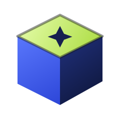

<div align="center">



# LeadForge

**Prospect intelligence and people-operations, in one studied front-end.**

A multi-page, framework-free website that researches and answers **two separate problem statements** —
an AI-powered lead-generation concept and an HR professional app design — backed by real, interactive
prototypes rather than slideware.


</div>

---

## Table of contents

- [Overview](#overview)
- [The two problems we answer](#the-two-problems-we-answer)
- [Feature highlights](#feature-highlights)
- [Site map](#site-map)
- [Project structure](#project-structure)
- [Tech stack](#tech-stack)
- [Run it locally](#run-it-locally)
- [Backend-ready architecture](#backend-ready-architecture)
- [Honest scope and limitations](#honest-scope-and-limitations)
- [Deploy to Netlify](#deploy-to-netlify)
- [Team](#team)
- [License](#license)

---

## Overview

LeadForge is a complete, production-style **static front-end** built with nothing but HTML, CSS and
vanilla JavaScript — no build step, no bundler, no npm required. It was created as a class assignment
that had to satisfy **two different briefs at once**, so the site is organised as two clearly separated
*tracks* plus a shared research and legal layer.

Everything on the site is real and interactive: the lead engine scores and filters 12 sample
organisations, the pipeline workspace exports CSV, and the HR app prototype lets you switch roles and
use onboarding, clock-in, benefits, goals, announcements and reporting — all persisted locally.

> **Design goal:** make the *front-end* so complete and so cleanly separated from data that a real
> backend can be dropped in behind it without rewriting a single page.

---

## The two problems we answer

### Track 01 — AI-Powered Lead Generation and Client Identification

*Problem:* sales and business-development teams waste hours manually hunting for prospects across the
web, guessing at fit, and maintaining spreadsheets that go stale. There is no consistent, explainable
way to turn scattered public signals into a qualified, prioritised lead list.

*What we deliver:*

- A transparent, **factor-weighted scoring engine** (sector, company size, region, buying signals,
  source reliability) — see [assets/lead-engine.js](assets/lead-engine.js).
- An interactive **qualification workspace** where you tune weights with sliders and watch the
  shortlist re-rank live, then **export a CSV** — see [workspace.html](workspace.html).
- A researched concept, feasibility study and persona set that frame the problem honestly.

### Track 02 — HRMM504 HR professional app

*Problem:* the course brief asks for research into HR technology, a neutral review of existing apps,
feedback from HR professionals, defined personas and a **comprehensive design for an HR app**.

*What we deliver:*

- A written design and study plan — see [people.html](people.html), [research.html](research.html),
  [personas.html](personas.html) and [feasibility.html](feasibility.html).
- A **clickable, role-aware prototype** of the prioritised feature set (P0 onboarding, self-service,
  time & attendance, benefits; P1 performance, communication, reporting) — see
  [hr-app.html](hr-app.html).
- A requirements traceability page that maps every line of both briefs to what is delivered — see
  [solution.html](solution.html).

---

## Feature highlights

- **Animated glassmorphism navbar** that reacts on scroll, with a mobile menu and `aria-current` state.
- **3D logo** with CSS `preserve-3d` tilt and a slow sway animation (SVG, gradient-lit).
- **Motion system:** scroll-reveal via `IntersectionObserver`, staggered children, word-by-word hero
  text, typewriter rotators, animated counters, a scroll-driven timeline that fills as you read, and
  pointer-tilt cards — all disabled cleanly under `prefers-reduced-motion`.
- **Interactive prototypes:** lead workspace, pipeline store with `localStorage`, and the HR app shell.
- **CSV export** with `Blob` + `URL.createObjectURL`.
- **Accessibility:** skip link, focus-visible rings, ARIA tabs/panels, live regions, semantic landmarks.
- **Legal pages:** privacy, terms and cookies.
- **Fully responsive** from 320px phones up to wide desktops.

---

## Site map

| Page | Purpose |
| --- | --- |
| [`index.html`](index.html) | Landing page: hero, stats, problem→fix map and the two-track overview |
| [`platform.html`](platform.html) | Track 01 — the AI lead-generation concept |
| [`workspace.html`](workspace.html) | Track 01 — interactive lead qualification workspace + CSV export |
| [`people.html`](people.html) | Track 02 — HR app design concept |
| [`hr-app.html`](hr-app.html) | Track 02 — clickable HR app prototype |
| [`solution.html`](solution.html) | Requirements traceability: honest map of what is delivered vs. not |
| [`research.html`](research.html) | Research plan and methods |
| [`personas.html`](personas.html) | Defined user personas |
| [`feasibility.html`](feasibility.html) | Feasibility study |
| [`team.html`](team.html) | The five creators, with a scroll-driven timeline |
| [`contact.html`](contact.html) | Feedback form (local-only) |
| [`privacy.html`](privacy.html) · [`terms.html`](terms.html) · [`cookies.html`](cookies.html) | Legal pages |

---

## Project structure

```
webinterface/
├── index.html              # Landing page
├── platform.html           # Track 01 — lead-generation concept
├── workspace.html          # Track 01 — interactive qualification workspace
├── people.html             # Track 02 — HR app design
├── hr-app.html             # Track 02 — HR app prototype
├── solution.html           # Requirements traceability
├── research.html           # Research plan
├── personas.html           # Personas
├── feasibility.html        # Feasibility study
├── team.html               # Creators + timeline
├── contact.html            # Feedback form
├── privacy.html            # Legal
├── terms.html              # Legal
├── cookies.html            # Legal
├── assets/
│   ├── styles.css          # Single stylesheet (design tokens + all components)
│   ├── site.js             # Shared behaviour (nav, reveals, counters, timeline, tilt)
│   ├── lead-engine.js      # Scoring engine + sample data + Store (Track 01)
│   ├── workspace.js        # Workspace UI binding (Track 01)
│   ├── hr-app.js           # HR prototype behaviour (Track 02)
│   ├── logo-leadforge.svg  # 3D logo
│   └── favicon.svg
├── favicon.ico             # Root icon (16/32/48) so browsers that request it get one
├── serve.py                # Local dev server (HTTP/1.1 keep-alive, caching off)
├── HRMM504 CA1 2026 (1).docx   # Source assignment brief (Track 02)
├── .gitignore
└── README.md
```

---

## Tech stack

| Layer | Choice | Why |
| --- | --- | --- |
| Markup | Semantic HTML5 | Accessible, crawlable, zero build |
| Styling | Modern CSS (custom properties, `clamp()`, grid, `backdrop-filter`, 3D transforms) | Powerful without a preprocessor |
| Behaviour | Vanilla ES2020 JavaScript (IIFE modules) | No framework, no bundler, no runtime deps |
| Data | In-memory sample data + `localStorage` | Swappable for a real API |

There is **no build step**. Open a file and it runs.

---

## Run it locally

The repository ships a small dev server that speaks **HTTP/1.1 with keep-alive** and disables
caching, which avoids the `net::ERR_ABORTED` that Python's built-in one-liner can trigger:

```bash
# from the project root
py serve.py
```

Then open <http://127.0.0.1:8765/>.

Zero-extra-files alternative (works, but closes the connection after every response):

```bash
py -m http.server 8765 --bind 127.0.0.1
```

> Opening `index.html` directly with `file://` also works, but a local server is recommended so that
> relative asset paths and the `localStorage` demos behave exactly as they do in production.

---

## Backend-ready architecture

The front-end talks to data only through a small, swappable boundary, so replacing demo data with a
real service is a contained change:

- **`window.LeadForge`** ([assets/lead-engine.js](assets/lead-engine.js)) exposes `LEADS`, `FACTORS`,
  `DEFAULT_WEIGHTS`, `scoreLead`, `query`, `toCSV` and a `Store` wrapper. Swap `LEADS` for a `fetch()`
  and the workspace UI keeps working unchanged.
- **`Store`** centralises persistence behind `load`/`save`, so `localStorage` can become an API client.
- The **HR prototype** reads and writes all state through one key, so it can be pointed at a server
  without touching markup.

---

## Honest scope and limitations

This is intentionally a **front-end**. As documented on the [traceability page](solution.html), a
static site genuinely **cannot**:

- run live web search or scrape public sources (a crawler/API is required),
- run a real AI model (a hosted model or agent is required),
- provide accounts, shared teams or a database (a backend is required).

Those are marked **“Needs backend”** rather than faked. Everything else — the scoring logic, the
interactive tools, the prototype behaviour, the research framing — is genuinely implemented.

---

## Deploy to Netlify

The site is a static bundle, so Netlify can host it with no configuration.

1. Push this repository to GitHub (already done once the remote is set).
2. In Netlify choose **Add new site → Import an existing project → GitHub**.
3. Authorise Netlify and pick the `LeadForge` repository.
4. Build settings: **Build command** *(leave empty)*, **Publish directory** `.` (the repo root).
5. Click **Deploy site**. Every future `git push` to `main` auto-deploys.

---

## Team

Built by the LeadForge team — five problem solvers:
**Akhil Tiwari · Anant Tiwari · Sandeep Gorai · Ilhan Helal · Arjun P**

See [team.html](team.html) for the full creator cards and timeline.

---

## License

Released under the **MIT License**. The `HRMM504 CA1 2026` brief remains the property of its author
and is included only as the source problem statement.
